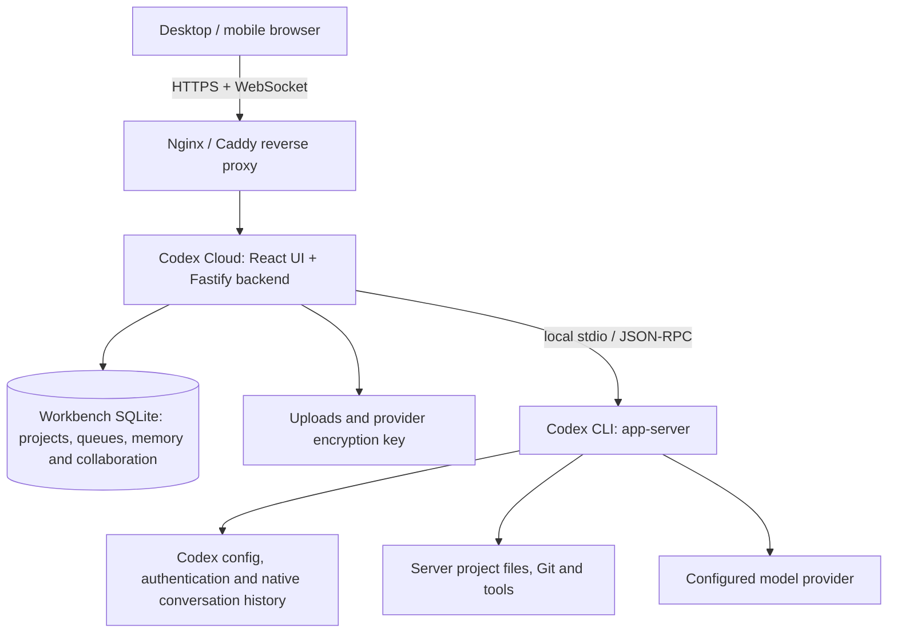

# Codex Cloud

[简体中文](README.md) · [Documentation](docs/en/INDEX.md) · [Changelog](docs/en/RELEASE.md)

Codex Cloud is a self-hosted coding workbench built on Codex App Server. Use a browser to select projects on your server, collaborate with models, inspect files and changes, and respond to execution approvals. The deployment machine runs the CLI and project tools; the browser does not need a development environment.

## Capabilities

- **Projects and conversations**: register directories, search, fork, rename and delete conversations, and configure project instructions.
- **Task execution**: stream replies, tool output, plans and diffs; handle approvals and questions; queue, steer or stop tasks.
- **Cross-conversation memory**: enable it under Settings → General → Memory and collaboration. Add project or instance-wide notes in the sidebar's Memory page, or save a conversation message as a note. The workbench selects relevant notes for new turns; notes can be edited, disabled or deleted.
- **Conversation collaboration**: enable it in the same settings section, then use the sidebar's Collaboration page to select existing conversations, set a shared goal, give each conversation instructions and choose a step limit. Each completed turn passes its final reply to the next conversation. Runs can be paused, resumed or stopped, and participating conversations may belong to different projects. Both features start disabled; see the [User guide](docs/en/PRODUCT.md#cross-conversation-memory-and-collaboration).
- **Result inspection**: browse files, navigate to line/column references, preview and zoom images, and inspect Git or conversation diffs.
- **Model providers**: save multiple providers, explicitly fetch and persist model catalogs, configure outbound proxies, and query supported balance endpoints.
- **Instance maintenance**: manage Skills, MCP and CLI versions; inspect usage; export backups or migrate to another machine.

This is a single-instance workbench for trusted users. Logged-in users share the service account, project access and provider settings. It does not implement tenant isolation or role-based access. Providers must support the Responses API, streaming and tool calls; Chat Completions compatibility alone is insufficient.

## Architecture at a glance



Production usually uses Nginx or Caddy for HTTPS; local development can connect to Vite directly. Project files and deployment configuration require separate backups. See [Operations](docs/en/OPERATIONS.md) for backup scope and [Architecture](docs/en/ARCHITECTURE.md) for component details.

> It is recommended to prepare a domain with SSL enabled.

## Local quick start

Install Node.js 24+ with npm, Git, and a working Codex CLI. The installer currently pins CLI `0.159.3`; an existing compatible version can be reused.

Run from the repository root:

```bash
node --version
npm install -g @openai/codex@0.159.3
npm ci --include=dev
npm run password
npm run dev
```

Choose an 8–1024 character website password. Open **http://127.0.0.1:18473**, sign in, add a project, and configure a provider under Settings → Providers, or use the service account's existing CLI configuration. A fresh checkout can run locally without `.env`; it includes no password, API key or configured provider.

For everyday use of a production build, stop the development server first:

```bash
npm run build
npm run start:local
```

On Windows, use `npm.cmd` if necessary. After initial setup, `Start-Dev.bat` and `Start-Local.bat` provide launch shortcuts; macOS uses the corresponding `.command` files. See [Local use](docs/en/LOCAL.md) for modes, ports and troubleshooting.

## Server deployment

Production uses a build, HTTPS and a background service. The Node backend normally listens on `127.0.0.1:18474`; a local Nginx or Caddy instance exposes HTTPS on port 443.

| Environment                     | Guide                                               |
| ------------------------------- | --------------------------------------------------- |
| Linux / systemd                 | [Linux deployment](docs/en/LINUX.md)                |
| Existing BT Panel site          | [Existing Nginx and certificates](docs/en/BAOTA.md) |
| Windows background operation    | [Windows deployment](docs/en/WINDOWS.md)            |
| macOS after user login          | [macOS deployment](docs/en/MACOS.md)                |
| Choosing an installation method | [Deployment overview](docs/en/DEPLOYMENT.md)        |

`.env.example` and `deploy/linux.env.example` are annotated templates. Copy one into the **running application's directory** and set your own values. Do not commit actual `.env` files, databases, certificates or credentials. See [Configuration](docs/en/CONFIGURATION.md) for every variable and precedence rule.

## Models and proxies

Save a provider URL and key in Settings → Providers, then click “获取模型” (Fetch models). Successful retrieval persists the catalog in the database. Reloading the page or restarting the service does not contact the provider again; another click explicitly refreshes it. Failed requests preserve the previous catalog.

Outbound proxies use `HTTP_PROXY`, `HTTPS_PROXY` and `NO_PROXY`. Restart the backend after changes. See [Providers](docs/en/PROVIDERS.md) for endpoint paths, caching, switching and error handling.

## Development and validation

```bash
npm run check
npm run build
npx playwright install chromium
npm run test:e2e
```

`check` runs type checks, formatting checks and unit/integration tests. Browser tests use isolated data and a mock executor. Validate real models, OS sandboxing and service startup on the target system; mock results do not establish those properties.

| Directory             | Contents                                                               |
| --------------------- | ---------------------------------------------------------------------- |
| `src/`                | React views, settings, file previews and browser state                 |
| `server/`             | APIs, executor bridge, scheduling, storage and maintenance             |
| `shared/`             | Shared types, protocol validation and event reduction                  |
| `scripts/`, `deploy/` | Installation, launch, backup, packaging tools and deployment templates |
| `tests/`              | Automated test source, without real runtime data                       |
| `docs/`, `docs/en/`   | Chinese documentation and paired English versions                      |

Read next: [User guide](docs/en/PRODUCT.md) · [Architecture](docs/en/ARCHITECTURE.md) · [API](docs/en/API.md) · [Development](docs/en/RD.md) · [Backups and upgrades](docs/en/OPERATIONS.md)
