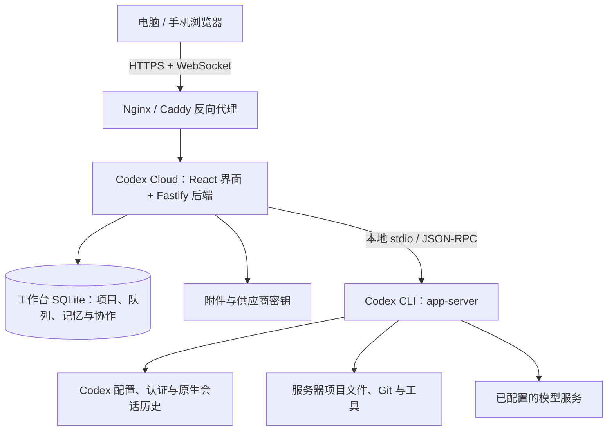

# Codex Cloud

[English](README.en.md) · [文档](docs/INDEX.md) · [更新记录](docs/RELEASE.md)

Codex Cloud 是基于 Codex App Server 的自托管编程工作台。在浏览器中选择服务器上的项目、与模型协作、查看文件和改动，并处理执行审批。任务由部署机器上的 CLI 和工具链运行，浏览器无需安装开发环境。

## 可以做什么

- **管理项目与会话**：添加项目目录，搜索、分叉、重命名和删除会话，设置项目提示词。
- **跨会话记忆**：在“设置 → 常规 → 记忆与协作”开启后，可从侧栏“记忆库”添加项目记忆或跨项目记忆，也可将会话消息保存为记忆。发送新消息时，工作台会选取相关记忆作为参考；记忆可编辑、停用和删除。
- **会话协作**：在同一设置位置开启后，可从侧栏“协作”选择多个已有会话，设置共同目标、各会话要求和执行步数。每轮完成后，最终回复会交给下一位会话；运行可暂停、继续或结束。参与会话可属于不同项目。两项功能默认关闭，详见[使用指南](docs/PRODUCT.md#跨会话记忆与协作)。
- **执行编程任务**：流式查看回复、工具输出、计划和差异；处理审批与追问；排队、补充指令或停止任务。
- **检查工作结果**：浏览文件、定位行列、预览和放大图片，查看 Git 与会话差异。
- **配置模型供应商**：保存多组供应商配置，手动获取并持久化模型列表，配置出站代理，查询支持的余额接口。
- **维护实例**：管理 Skills、MCP 和 CLI 版本，查看用量，导出备份或迁移到其他机器。

这是面向可信使用者的单实例工作台。登录用户共享服务账户、项目访问权限和供应商配置；项目不提供多租户或角色权限隔离。模型接口需兼容 Responses API、流式响应和工具调用，仅兼容 Chat Completions 的接口不足以运行完整任务。

## 架构概览



生产部署通常由 Nginx 或 Caddy 提供 HTTPS；本地开发可直接访问 Vite。项目文件和部署配置不属于迁移包，备份范围见[运维指南](docs/OPERATIONS.md)。组件职责和数据流见[系统架构](docs/ARCHITECTURE.md)。

> 建议准备一个开启了SSL的域名。

## 本地快速开始

需要 Node.js 24+（含 npm）、Git，以及可运行的 Codex CLI。安装向导当前固定 CLI 版本为 `0.159.3`；已有兼容版本可以复用。

在项目根目录执行：

```bash
node --version
npm install -g @openai/codex@0.159.3
npm ci --include=dev
npm run password
npm run dev
```

首次设置 8～1024 字符的网站密码。打开 **http://127.0.0.1:18473**，登录后添加一个项目，在“设置 → 供应商”配置模型服务，或使用服务账户已有的 CLI 配置。新源码目录无需创建 `.env` 即可本地开发；不会自带密码、Key 或可用供应商。

日常使用构建版：先停止开发服务，再执行：

```bash
npm run build
npm run start:local
```

Windows 可使用 `npm.cmd`；完成依赖安装和密码设置后，也可双击 `Start-Dev.bat` 或 `Start-Local.bat`。macOS 对应 `.command` 文件。启动模式、端口与常见问题见[本地使用](docs/LOCAL.md)。

## 部署到服务器

生产环境使用构建版、HTTPS 和后台服务。Node 后端通常只监听 `127.0.0.1:18474`，由同机 Nginx 或 Caddy 对外提供 443 端口服务。

| 场景                 | 操作指南                               |
| -------------------- | -------------------------------------- |
| Linux / systemd      | [Linux 部署](docs/LINUX.md)            |
| 已有宝塔站点         | [接入现有 Nginx 与证书](docs/BAOTA.md) |
| Windows 后台运行     | [Windows 部署](docs/WINDOWS.md)        |
| macOS 登录后后台运行 | [macOS 部署](docs/MACOS.md)            |
| 选择安装方式         | [生产部署总览](docs/DEPLOYMENT.md)     |

`.env.example` 和 `deploy/linux.env.example` 是带逐项注释的模板。复制到**实际运行目录**后填写自己的值；不要将实际 `.env`、数据库、证书或凭据提交到 Git。所有变量及覆盖规则见[配置参考](docs/CONFIGURATION.md)。

## 模型与代理

在“设置 → 供应商”保存 API 基础地址和 Key，再点击“获取模型”。获取成功后列表保存在数据库；刷新页面和重启服务不会重新请求供应商，只有再次点击才会更新。失败保留旧列表。

出站代理使用 `HTTP_PROXY`、`HTTPS_PROXY`、`NO_PROXY`，配置变更后重启后端。模型接口路径、缓存规则、切换行为和错误处理见[供应商指南](docs/PROVIDERS.md)。

## 开发与验证

```bash
npm run check
npm run build
npx playwright install chromium
npm run test:e2e
```

`check` 执行类型检查、格式检查和单元/集成测试；浏览器测试使用隔离目录与模拟执行器。真实模型、操作系统沙箱和后台启动需要在目标环境验收，不能由模拟测试结果推断。

| 目录                  | 内容                                   |
| --------------------- | -------------------------------------- |
| `src/`                | React 页面、设置、文件预览和浏览器状态 |
| `server/`             | API、执行器桥接、调度、存储和维护      |
| `shared/`             | 前后端共享类型、协议校验和事件归并     |
| `scripts/`、`deploy/` | 安装、启动、备份、打包工具及部署模板   |
| `tests/`              | 自动化测试代码，不含真实运行数据       |
| `docs/`、`docs/en/`   | 中文文档及对应英文版本                 |

继续阅读：[使用指南](docs/PRODUCT.md) · [系统架构](docs/ARCHITECTURE.md) · [API](docs/API.md) · [开发指南](docs/RD.md) · [备份与升级](docs/OPERATIONS.md)

## 致谢

[LINUX DO](https://linux.do)


