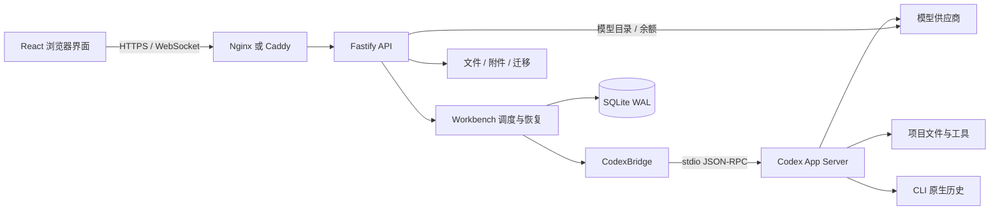

# 系统架构

[English](en/ARCHITECTURE.md) · [文档目录](INDEX.md) · [项目首页](../README.md)

Codex Cloud 由浏览器界面、Node 后端和后端持有的 Codex App Server 组成。Web 层管理认证、项目与执行状态，CLI 负责模型交互及工具执行。一个实例对应一个共享信任范围，不提供跨实例任务调度。

## 组件与数据流

本地开发由 Vite 提供前端并代理 API；构建版由 Fastify 提供 `dist/client`。生产环境的 HTTPS 和 WebSocket 转发交给反向代理。技术栈为 React 19、TypeScript、Vite 7、Node 24、Fastify 5 和 SQLite；外部输入以 Zod 校验。

| 模块                                                                                                     | 职责                               |
| -------------------------------------------------------------------------------------------------------- | ---------------------------------- |
| [src/App.tsx](../src/App.tsx)、[shared/events.ts](../shared/events.ts)                                   | 页面状态、快照与实时事件归并       |
| [src/settings/](../src/settings/)、[src/files/](../src/files/)                                           | 管理界面、文件与图片交互           |
| [server/app.ts](../server/app.ts)、[server/management-api.ts](../server/management-api.ts)               | 路由、认证、Origin、参数与资源限制 |
| [server/workbench.ts](../server/workbench.ts)                                                            | 会话、执行、队列、审批、维护和恢复 |
| [server/continuity.ts](../server/continuity.ts)                                                          | 记忆、协作组、交接与运行恢复       |
| [server/codex.ts](../server/codex.ts)、[shared/protocol.ts](../shared/protocol.ts)                       | 子进程、RPC 请求关联、协议校验     |
| [server/store.ts](../server/store.ts)                                                                    | 数据库模式、索引、运行与事件持久化 |
| [server/providers.ts](../server/providers.ts)、[server/provider-models.ts](../server/provider-models.ts) | 凭据、供应商目录与显式更新         |
| [server/files.ts](../server/files.ts)、[server/migration.ts](../server/migration.ts)                     | 文件边界、Git、迁移校验和恢复      |

## 任务执行与竞争控制

消息提交依次经过登录/Origin 校验、参数与文件边界检查、会话状态检查、会话互斥和并发容量检查，之后才进入 CLI。附件在实际提交或入队边界标记为已使用，校验失败不会提前消耗草稿附件。

- 同一项目及不同项目的会话共享 `MAX_CONCURRENT_TURNS` 并发容量；已运行和正在启动的会话均计入上限。单个会话仍串行，同项目会话共享磁盘文件。
- 队列持久化在工作台数据库，不使用 CLI 实验性原生队列。正常完成后推进，失败、中断或重启后暂停相关队列。
- `turn/start` 结果不明确时不会自动重发，以免重复执行工具。过早到达的停止请求会在取得原生轮次 ID 后处理。
- 审批和追问通过后端登记并关联请求 ID；已解决的请求不能再次生效。未知交互请求明确返回不支持。
- 供应商切换、扩展更新、CLI 更新和迁移等操作受维护/空闲约束。强制停止作用于实例持有的整个执行器。

网页连接只负责观察和发起操作；连接中断不等于 CLI 停止。工作台不会通过重新提交用户消息来修复丢失的响应。

## 历史与事件恢复

CLI 原生会话历史是会话正文的权威来源。SQLite 事件表提供有限时间与数量的重放，内存缓存加快读取；它们都不能替代原生历史备份。记忆和协作运行记录存于独立业务表，事件清理不会移除它们。

WebSocket `/api/events?after=seq` 发送 `hello`、`event`、`synced`。事件序号用于去重和检测缺口。游标过旧、超前、不连续或超过重放预算时，`hello.reset` 要求客户端重新加载快照。快照读取期间收到的增量需要在快照后合并，不能直接丢弃。

原生完成条目替换先前的流式增量，避免正文重复拼接。历史读取兼容分页能力差异；用量和每轮模型按轮次记录，不能从当前输入框选项倒推历史。协议细节见 [API](API.md)。

## 存储职责

| 位置                                                 | 数据及维护含义                                               |
| ---------------------------------------------------- | ------------------------------------------------------------ |
| `DATA_DIR/workbench.sqlite`                          | 登录会话、项目、运行、队列、事件、用量与供应商设置；使用 WAL |
| `DATA_DIR/providers.key`                             | 供应商 Key 的加密材料，与数据库配套备份                      |
| `DATA_DIR/uploads`                                   | 附件内容，与附件索引保持一致                                 |
| `DATA_DIR/logs`                                      | 诊断日志，受轮转和清理预算约束                               |
| `CODEX_HOME`                                         | CLI 配置、认证和原生会话历史                                 |
| `CODEX_CLOUD_SKILLS_HOME`（默认 `~/.agents/skills`） | 用户 Skills                                                  |
| 项目目录                                             | 源码、Git、项目依赖及工具输出，独立备份                      |
| 浏览器存储                                           | 界面偏好和标签页草稿，不是服务端备份的一部分                 |

数据目录锁防止多个实例同时管理同一份状态；它不提供分布式锁或集群协调。迁移通过校验、路径映射和维护锁安装恢复结果，具体范围见[运维](OPERATIONS.md)。

## 权限与凭据边界

网站密码使用 scrypt，登录令牌以哈希形式存储。受保护 API 要求 Cookie，状态修改与 WebSocket 校验精确 Origin。登录即获得此实例的共享管理权限。

文件接口检查真实路径，限制目录穿越、外部符号链接及 Git 内部文件访问；图片响应设置 MIME 和沙箱 CSP。`PROJECT_ROOTS` 约束项目选择/文件 API，不限制 CLI 在全权限执行策略下的全部访问。

供应商 Key 使用 AES-256-GCM，不返回浏览器，执行时通过后端持有的子进程环境传递。出站代理在加载 `.env` 后配置后端 fetch，同时由 CLI 子进程继承；反向代理和 `TRUST_PROXY` 属于另一条入站请求链路。

## 兼容性维护

安装器当前固定 CLI `0.159.3`；代码中的 `0.155.1` 标识历史协议基线，不代表全功能覆盖或必须使用该旧版本。升级需同时核对请求、通知、交互响应、模拟器及真实供应商行为，参见[执行器覆盖](CODEX-API-COVERAGE.md)和[测试与验收](VALIDATION.md)。
