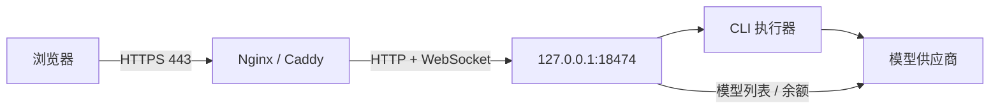

# 生产部署总览

[English](en/DEPLOYMENT.md) · [文档目录](INDEX.md) · [项目首页](../README.md)

生产部署由四部分组成：应用构建文件、可持久化的数据目录、同机 HTTPS 反向代理，以及后台服务管理器。先确定运行账户与目录，再安装；避免将开发目录直接当作在线服务目录更新。

## 部署前确定的信息

| 项目       | 要确定的内容                                                  |
| ---------- | ------------------------------------------------------------- |
| 运行账户   | 谁执行 Node、CLI 和项目工具；该账户需要哪些目录权限           |
| 程序与数据 | 程序可替换；`.env`、`DATA_DIR`、`CODEX_HOME` 和项目文件需保留 |
| 外部访问   | 域名、HTTPS 端口、证书管理方式，以及已有反代是否继续使用      |
| 上游连接   | 供应商地址/Key，或服务账户已有 CLI 认证；是否需要出站代理     |
| 系统工具   | Node 24+、npm、CLI、Git，以及各项目自己的构建工具             |

安装器当前准备 Node `24.21.0` 和 CLI `0.159.3`，并可复用兼容的已有安装。程序要求 Node 主版本至少为 24；其他 CLI 版本需自行做集成验收。

## 选择部署方式

| 方式         | 适用场景                              | 入口                                                        |
| ------------ | ------------------------------------- | ----------------------------------------------------------- |
| 交互式安装器 | 希望自动准备依赖、网站和后台服务      | [安装器参考](INSTALL.md)                                    |
| 手动服务部署 | 已有 Node、反代、证书或需控制权限布局 | [Linux](LINUX.md)、[Windows](WINDOWS.md)、[macOS](MACOS.md) |
| 接入宝塔     | 面板已管理站点、证书和 Nginx          | [宝塔部署](BAOTA.md)                                        |

Linux/systemd 支持开机启动；Windows 使用计划任务，其登录条件取决于任务凭据；macOS 使用用户 LaunchAgent，需要用户登录，不能作为无人登录服务的等价替代。

## 网络布局



反代需支持 WebSocket 升级、长请求并关闭流式响应缓冲。公网通常只开放 80/443；80 供 HTTP 跳转或 ACME 验证。Node 端口保持回环监听。`TRUST_PROXY` 配置入站头部信任，`HTTP_PROXY/HTTPS_PROXY` 配置到供应商的出站连接，两者独立。

## 手动部署的固定顺序

1. 将完整源码放到目标程序目录，以运行账户执行 `npm ci --include=dev` 和 `npm run build`。
2. 复制 [.env.example](../.env.example) 或 [Linux 示例](../deploy/linux.env.example) 为运行目录中的 `.env`，配置实际路径和 Origin。
3. 以相同账户、相同工作目录执行 `npm run password`，确认 CLI 可启动。
4. 配置后台服务，使其工作目录指向程序目录，执行 `node dist/server/index.js`。
5. 启动后先检查后端，再配置 HTTPS 反代和公开访问。

```bash
curl --fail http://127.0.0.1:18474/api/auth/status
```

成功应返回 JSON 且 `configured` 为 `true`。该接口无需登录，只证明 HTTP 服务和密码初始化正常。

## 上线验收

依次验证 HTTPS 证书、登录、WebSocket 实时更新、供应商模型请求、项目工具访问和重启后历史恢复。每一步独立判断：`active (running)` 不证明模型能用，模型列表获取成功也不证明工具调用兼容。

更新已有实例按[运维指南](OPERATIONS.md)先备份、等待空闲并停止服务。不要覆盖运行中的数据库或复制其他系统的 `node_modules`。环境变量的完整定义见[配置参考](CONFIGURATION.md)。
