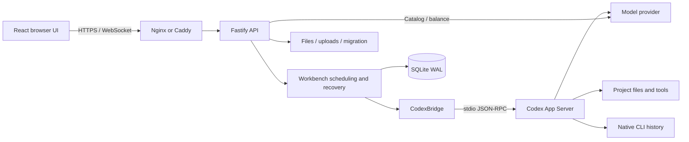

# Architecture

[简体中文](../ARCHITECTURE.md) · [Documentation](INDEX.md) · [Project home](../../README.en.md)

Codex Cloud consists of a browser UI, a Node backend and a Codex App Server owned by that backend. The web layer manages authentication, projects and execution state; the CLI handles model interaction and tool execution. Each instance serves one shared trust boundary without cross-instance scheduling.

## Components and data flow

Vite serves the development UI and proxies API requests. Production builds serve `dist/client` through Fastify, with HTTPS and WebSocket forwarding handled by a reverse proxy. The stack uses React 19, TypeScript, Vite 7, Node 24, Fastify 5 and SQLite; Zod validates external input.

| Module                                                                                                         | Responsibility                                                    |
| -------------------------------------------------------------------------------------------------------------- | ----------------------------------------------------------------- |
| [src/App.tsx](../../src/App.tsx), [shared/events.ts](../../shared/events.ts)                                   | UI state, snapshots and live-event merging                        |
| [src/settings/](../../src/settings/), [src/files/](../../src/files/)                                           | Management, files and image interactions                          |
| [server/app.ts](../../server/app.ts), [server/management-api.ts](../../server/management-api.ts)               | Routes, authentication, Origin, validation and limits             |
| [server/workbench.ts](../../server/workbench.ts)                                                               | Conversations, tasks, queues, approvals, maintenance and recovery |
| [server/continuity.ts](../../server/continuity.ts)                                                             | Memory, collaboration groups, handoffs and run recovery           |
| [server/codex.ts](../../server/codex.ts), [shared/protocol.ts](../../shared/protocol.ts)                       | Child process, RPC correlation and protocol validation            |
| [server/store.ts](../../server/store.ts)                                                                       | Database schema, indexes, runs and persisted events               |
| [server/providers.ts](../../server/providers.ts), [server/provider-models.ts](../../server/provider-models.ts) | Credentials, catalogs and explicit refresh                        |
| [server/files.ts](../../server/files.ts), [server/migration.ts](../../server/migration.ts)                     | File boundaries, Git, archive validation and restore              |

## Execution and concurrency

Messages pass authentication/Origin checks, input and file validation, conversation-state checks, conversation locking and capacity checks before reaching the CLI. Attachments are claimed at the actual submission/queue boundary so validation failures do not consume draft attachments.

- Conversations in the same and different projects share `MAX_CONCURRENT_TURNS` capacity, counting both active and starting turns. Each conversation remains serial; same-project conversations share files.
- Queues persist in the workbench database rather than the CLI's experimental native queue. Normal completion advances them; failures, interruptions and restarts pause affected queues.
- Uncertain `turn/start` results are not automatically retried, avoiding duplicate tool execution. Early stop requests are handled once the native turn ID is known.
- Approvals and questions are registered with correlated request IDs. Resolved requests cannot take effect twice; unknown interactions receive an unsupported response.
- Provider switching, extension changes, CLI updates and migration use maintenance/idle constraints. Force-stop affects the instance's entire owned executor.

A browser connection observes execution and submits operations. Losing it does not imply CLI termination. Recovery does not resubmit user messages to compensate for missing responses.

## History and event recovery

Native CLI history is authoritative for conversation content. SQLite events provide bounded replay, and memory caches accelerate reads. Neither replaces a native-history backup. Saved notes and collaboration runs use separate business tables and survive event-cache cleanup.

WebSocket `/api/events?after=seq` sends `hello`, `event` and `synced`. Sequence numbers support deduplication and gap detection. Old, future, discontinuous or over-budget cursors cause `hello.reset`, requiring a fresh snapshot. Events received while loading that snapshot must be merged afterward.

Completed native items replace streamed increments to avoid duplicated text. History reading accommodates pagination capability differences. Usage and models are recorded per turn rather than inferred from current composer settings. See [API](API.md) for the wire protocol.

## Storage responsibilities

| Location                                               | Content and maintenance implications                                            |
| ------------------------------------------------------ | ------------------------------------------------------------------------------- |
| `DATA_DIR/workbench.sqlite`                            | Sessions, projects, runs, queues, events, usage and provider settings; WAL mode |
| `DATA_DIR/providers.key`                               | Provider encryption material; back up with the database                         |
| `DATA_DIR/uploads`                                     | Attachment content, paired with its index                                       |
| `DATA_DIR/logs`                                        | Rotated diagnostics subject to cleanup budgets                                  |
| `CODEX_HOME`                                           | CLI configuration, authentication and native history                            |
| `CODEX_CLOUD_SKILLS_HOME` (default `~/.agents/skills`) | User Skills                                                                     |
| Project directories                                    | Source, Git, dependencies and tool output; separate backups                     |
| Browser storage                                        | Preferences and tab drafts; outside server backups                              |

The data-directory lock prevents concurrent instances from managing the same state. It is not a distributed lock. Migration validates archives and mappings and installs restored state under maintenance coordination; see [Operations](OPERATIONS.md) for scope.

## Permissions and credentials

Website passwords use scrypt; session tokens are stored as hashes. Protected APIs require a cookie, while mutations and WebSocket handshakes check the exact Origin. Signing in grants shared instance-management access.

File APIs resolve real paths and constrain traversal, external symlinks and Git internals. Image responses specify MIME types and a sandbox CSP. `PROJECT_ROOTS` constrains project selection/file APIs, not all CLI access under a full-access execution policy.

Provider keys use AES-256-GCM and are never returned to the browser. The backend passes them through its owned child-process environment. After loading `.env`, the application configures outbound fetch proxies; CLI children inherit proxy variables. Reverse proxies and `TRUST_PROXY` belong to the separate inbound path.

## Compatibility maintenance

The installer currently pins CLI `0.159.3`. References to `0.155.1` in code identify a historical protocol baseline, not full coverage or a requirement to use the older version. Upgrades require checking requests, notifications, interaction responses, mocks and real-provider behavior. See [Executor coverage](CODEX-API-COVERAGE.md) and [Testing](VALIDATION.md).
