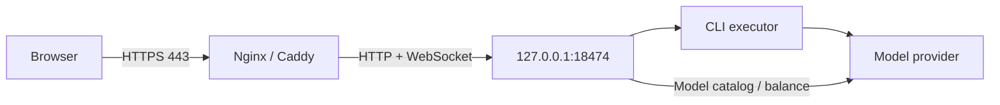

# Production deployment overview

[简体中文](../DEPLOYMENT.md) · [Documentation](INDEX.md) · [Project home](../../README.en.md)

A production installation combines built application files, persistent storage, a local HTTPS reverse proxy and a service manager. Choose accounts and directories before installation. Keep development checkouts separate from directories serving live traffic.

## Information to establish first

| Item             | Decision                                                                                  |
| ---------------- | ----------------------------------------------------------------------------------------- |
| Service account  | Which account runs Node, CLI and project tools, and which directories it can access       |
| Program and data | Replaceable program files versus persistent `.env`, `DATA_DIR`, `CODEX_HOME` and projects |
| Public access    | Domain, HTTPS port, certificate owner and any existing reverse proxy                      |
| Upstream access  | Provider URL/key or existing CLI authentication, plus any outbound proxy                  |
| Tools            | Node 24+, npm, CLI, Git and each project's own build tools                                |

The installer currently prepares Node `24.21.0` and CLI `0.159.3`, reusing compatible existing installations. Node major version 24 is the minimum. Validate other CLI versions against the integration.

## Choose a method

| Method                | Appropriate when                                                              | Guide                                                       |
| --------------------- | ----------------------------------------------------------------------------- | ----------------------------------------------------------- |
| Interactive installer | You want help preparing dependencies, website and services                    | [Installer](INSTALL.md)                                     |
| Manual service setup  | Node, proxy or certificates already exist, or permissions need custom control | [Linux](LINUX.md), [Windows](WINDOWS.md), [macOS](MACOS.md) |
| BT Panel integration  | The panel already owns Nginx, sites and certificates                          | [BT Panel](BAOTA.md)                                        |

Linux/systemd supports boot startup. Windows uses a scheduled task whose login behavior depends on its credentials. macOS uses a user LaunchAgent and requires login; it is not an unattended system daemon.

## Network layout



The reverse proxy must support WebSocket upgrades, long requests and unbuffered streaming. Normally expose only 80/443; port 80 handles redirects or ACME validation. Keep Node on loopback. `TRUST_PROXY` controls incoming header trust; `HTTP_PROXY/HTTPS_PROXY` control outbound provider connections.

## Manual installation sequence

1. Place the complete source in the program directory. As the runtime account, run `npm ci --include=dev` and `npm run build`.
2. Copy the [general template](../../.env.example) or [Linux template](../../deploy/linux.env.example) to `.env` there; configure actual paths and origin.
3. Run `npm run password` with the same account and working directory, and confirm the CLI starts.
4. Configure the service working directory and `node dist/server/index.js` command.
5. Start and check the backend before enabling HTTPS/public access.

```bash
curl --fail http://127.0.0.1:18474/api/auth/status
```

Expect JSON with `configured: true`. This unauthenticated endpoint establishes only HTTP availability and password initialization.

## Acceptance

Verify the HTTPS certificate, login, live WebSocket updates, provider calls, project-tool access and history after restart. Evaluate each separately: a running service does not prove model access, and a model catalog does not prove tool-call compatibility.

For upgrades, follow [Operations](OPERATIONS.md): back up, wait for idle state and stop the service. Do not replace a live database or copy `node_modules` from another OS. See [Configuration](CONFIGURATION.md) for complete variable definitions.
